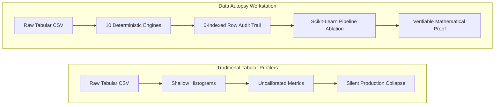
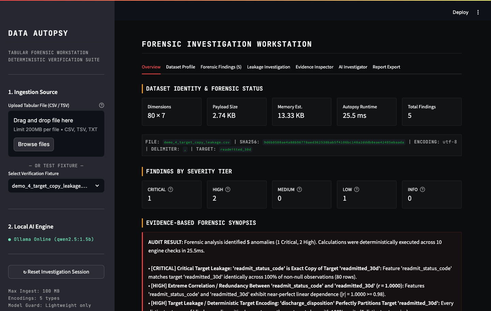
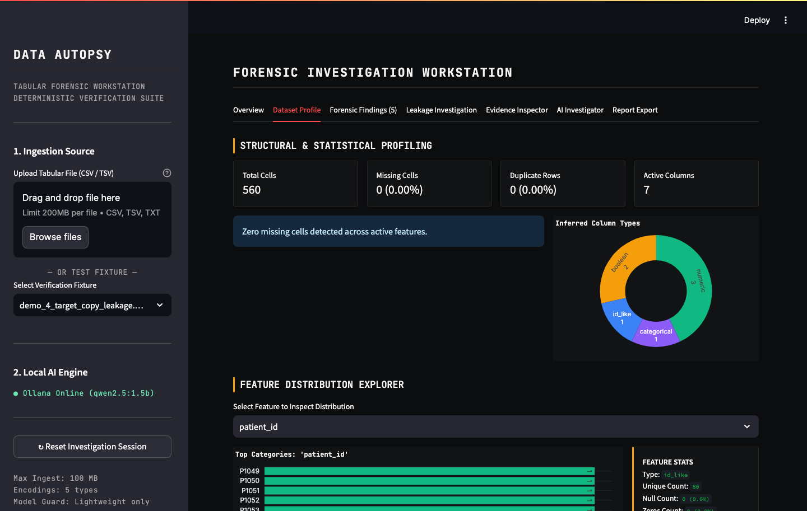
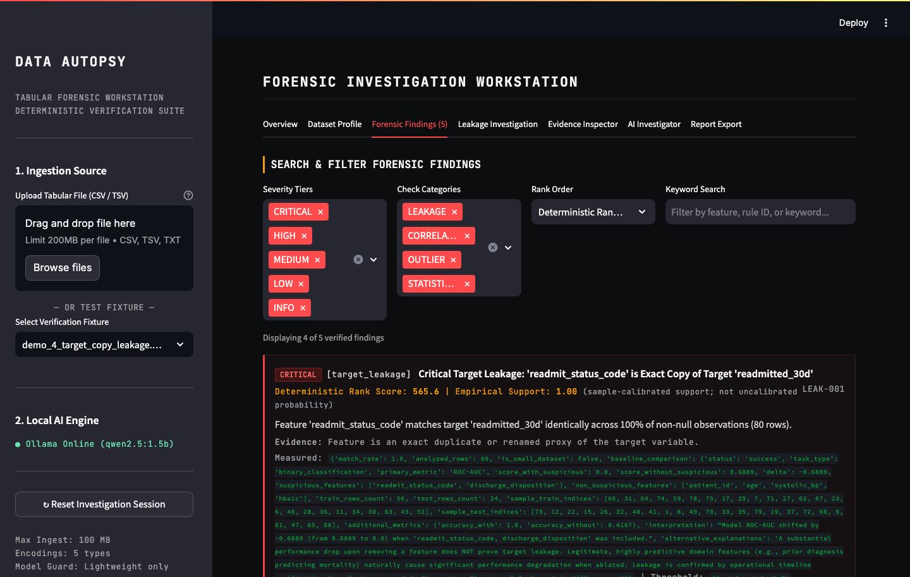
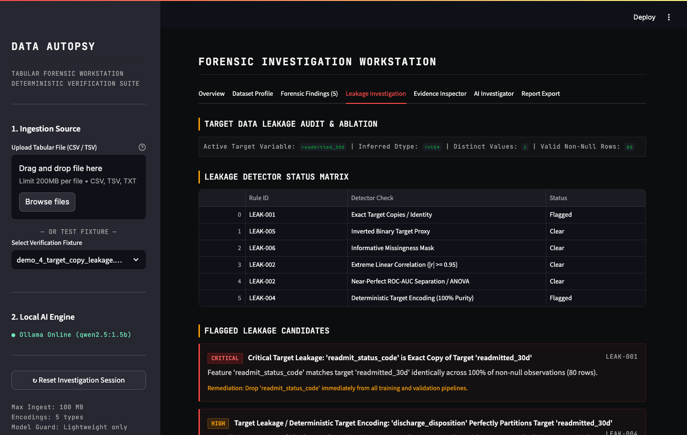
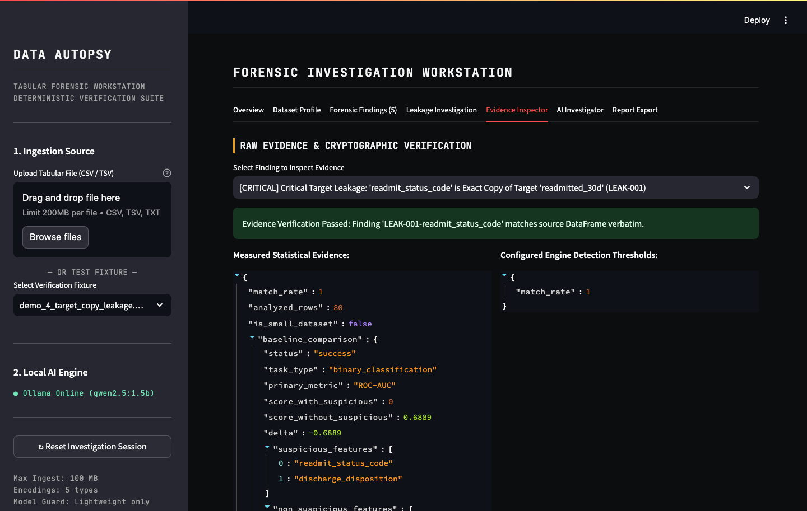
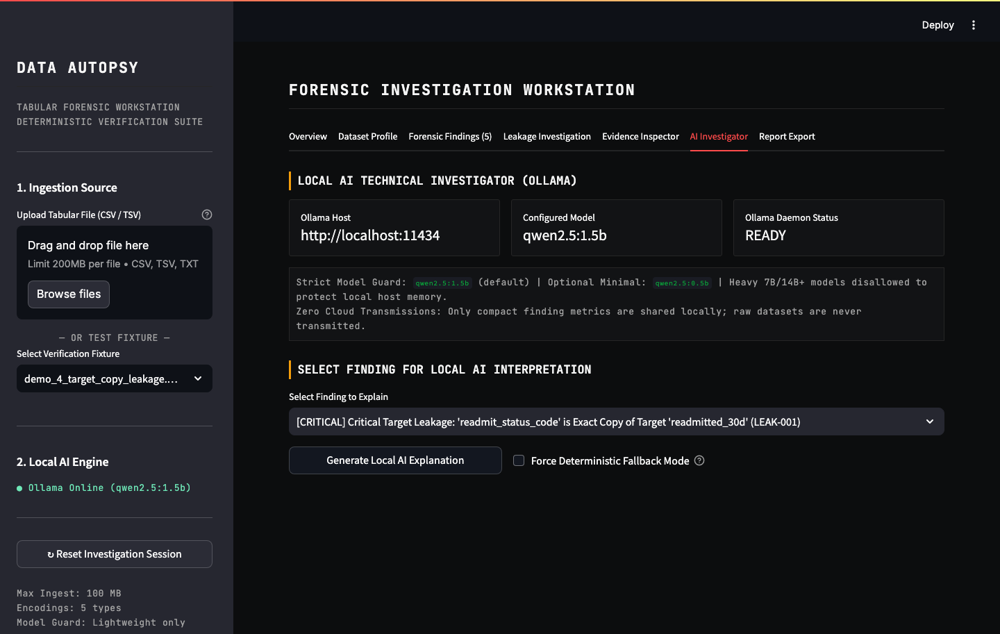
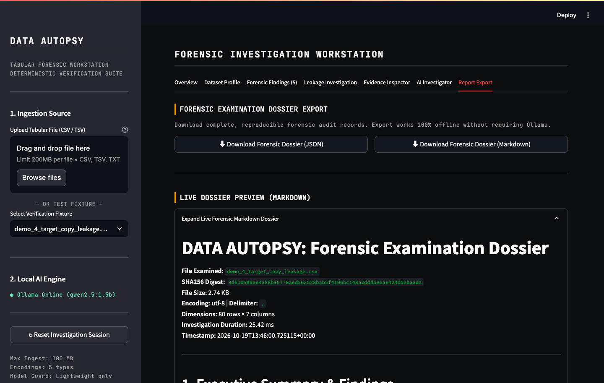
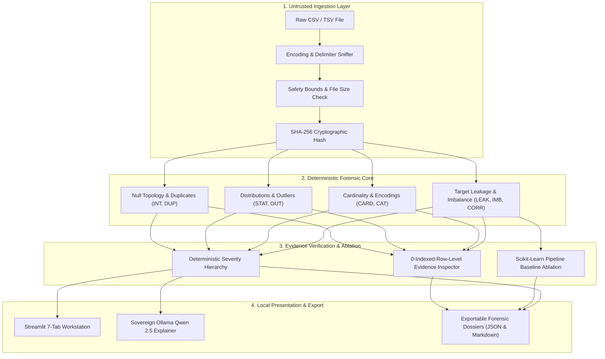

<div align="center">

# DATA AUTOPSY
### Serious AI Forensic Investigation Workstation for Tabular Datasets

[](https://www.python.org/downloads/)
[-brightgreen.svg)](https://github.com/)
[-orange.svg)](https://ollama.com)
[](https://github.com/)
[](https://github.com/)

**Detect target leakage, structural corruption, and statistical anomalies with reproducible evidence, verifiable row-level audit trails, and sovereign local AI.**

[Key Features](#key-features) • [Workstation Tour](#workstation-tour-screenshots) • [Forensic Detection Suite](#forensic-detection-suite) • [Quickstart](#quickstart--installation) • [Sample Datasets](#reproducible-demonstration-datasets) • [Privacy](#privacy--local-sovereignty)

</div>

---

## The Problem: Silent Tabular Failure

Machine learning models rarely fail in production because of bad algorithms. They fail from silent tabular defects that inflate validation scores before collapsing upon deployment:

* **Post-Event Target Leakage:** Features recorded downstream of the target outcome (e.g. readmission disposition codes) that give models 99% validation accuracy that vanishes in live environments.
* **Contaminated Splits:** Undetected duplicate rows leaking across train/test partitions, causing models to memorize records rather than generalize.
* **Disguised Identifiers:** High-cardinality keys and surrogate IDs passed as features, leading tree-based models to overfit on noise.
* **Masked Class Imbalance:** Severe 30:1 class skew obscured by naive uncalibrated accuracy metrics.
* **Misclassified Outliers:** Legitimate physical extremes (e.g. server network spikes) incorrectly scrubbed as data corruption.



---

## Key Features

* **10 Deterministic Forensic Engines:** 100% mathematically reproducible anomaly detection using Tukey IQR, modified Z-scores, Pearson correlations, ANOVA effect sizes, and mutual information. Zero hallucinations.
* **Verifiable Mathematical Evidence:** Every single alert links directly to exact original 0-indexed row locations and verbatim observed sample tuples.
* **Leakage Pipeline Ablation:** Automated Scikit-Learn evaluation trains two isolated pipelines (baseline vs ablated) with preprocessing fitted strictly on training splits to prove real-world metric drop.
* **Non-Mutating Column Exclusion:** Interactively drop columns from subsequent forensic analysis without modifying the source dataset on disk.
* **Sovereign Local AI (Ollama):** Optional plain-English explanations using local open-weight `qwen2.5:1.5b` or `qwen2.5:0.5b`. No data ever leaves your computer. Includes 100% offline deterministic fallback.
* **Exportable Forensic Dossiers:** Download comprehensive audit reports in standardized **JSON** and **Markdown** formats for compliance and code review.

---

## Workstation Tour (Screenshots)

### 1. Forensic Overview & Dataset Status
> Instant cryptographic verification (SHA-256), payload profiling, runtime benchmarks, and severity-tiered finding summaries.

<div align="center">
  
</div>

---

### 2. Dataset Profiling & Distribution Analytics
> Deep column structural analysis: inferred statistical types, exact missingness counts, unique ratios, memory consumption, and interactive Plotly distribution charts.

<div align="center">
  
</div>

---

### 3. Filterable Forensic Findings Matrix
> Deterministically ranked findings sorted by composite severity and sample-calibrated empirical support. Filter by severity tier or check category.

<div align="center">
  
</div>

---

### 4. Target Data Leakage Audit & Pipeline Ablation
> Detects exact target copies (`LEAK-001`), inverted binary targets (`LEAK-005`), and categorical encodings (`LEAK-004`). Trains dual Scikit-Learn pipelines to quantify accuracy collapse when suspicious columns are ablated.

<div align="center">
  
</div>

---

### 5. Evidence Inspector (Zero Hallucination Audit Trail)
> Forensic evidence viewer showing exact 0-indexed row numbers, raw values, and mathematical detection thresholds directly from the source table.

<div align="center">
  
</div>

---

### 6. Local AI Investigator (Ollama + Qwen 2.5)
> Sovereign AI interpretations generated locally on your workstation. Strictly explains verified findings without running calculations, inventing numbers, or sending telemetry to external clouds.

<div align="center">
  
</div>

---

### 7. Forensic Dossier Export
> One-click download of audit dossiers in Markdown and JSON formats, complete with metadata, baseline scores, and mathematical limitation boundaries.

<div align="center">
  
</div>

---

## Forensic Detection Suite

Data Autopsy executes 10 reproducible checks with explicit mathematical boundaries:

| # | Forensic Check | Rule ID(s) | Detection Threshold | Severity | What It Can Establish | What It Cannot Establish |
|---|---|---|---|---|---|---|
| 1 | **Missing Values** | `INT-001` - `INT-004` | 100% (Critical), ≥50% (High), ≥20% (Med) | Critical to Low | Null topology, unobserved columns | True missingness mechanism (MCAR vs MAR vs MNAR) |
| 2 | **Duplicate Records** | `DUP-001`, `DUP-002` | Exact match (>0%), Candidate key match | High to Low | Record duplication, inflated significance | Intentional multi-submission vs physical co-occurrence |
| 3 | **Constant Columns** | `STAT-001`, `STAT-002` | Unique count = 1, Single value ≥99% | Medium to Low | Zero-information features, singular covariance | Whether rare non-constant event is critical anomaly signal |
| 4 | **Potential Identifiers** | `STAT-003` | Unique ratio ≥98% with n ≥ 20 | Info | Database keys, surrogate IDs, memorization risk | Semantic meaning of the column without domain ontology |
| 5 | **Numeric Outliers** | `OUT-001` | Tukey IQR × 1.5, Modified Z-score > 3.5 | Medium to Low | Distributional deviations from central mass | Whether an outlier is entry error or valid heavy-tailed event |
| 6 | **High Cardinality** | `CARD-001` | Unique count ≥ 50 or ratio ≥ 30% | Low | One-hot explosion, tree overfitting risk | Optimal feature grouping or binning strategy |
| 7 | **Inconsistent Categories** | `CAT-001` | Whitespace padding, casing variations | Medium | Fragmented category representations | Intentional case distinctions (e.g. gene notation, base64) |
| 8 | **Class Imbalance** | `IMB-001`, `IMB-002` | Ratio ≥ 20:1 (High), ≥ 4:1 (Medium) | High to Medium | Class skew requiring stratified sampling | Whether imbalance is artificial bias or true base rate |
| 9 | **Strong Correlations** | `CORR-001`, `CORR-002` | Pearson \|r\| ≥ 0.98 (Extreme), ≥ 0.90 (High) | High to Medium | Multicollinearity, inflated coefficient variance | Exact substitution in non-linear models |
| 10 | **Target Data Leakage** | `LEAK-001` - `LEAK-004` | Direct copy, Inversion, \|r\| ≥ 0.95, Purity = 1.0 | Critical to High | Exact target copies, pure categorical encodings | Causal direction or temporal event sequence from static snapshot |

---

## Quickstart & Installation

### Prerequisites
* **Python:** 3.11 or higher
* **RAM:** Minimum 4 GB (8 GB recommended)
* **OS:** macOS (Apple Silicon or Intel), Linux, or Windows

### 1. Set Up Environment

```bash
# Clone the repository and enter directory
cd data-autopsy

# Create and activate virtual environment
python3.11 -m venv .venv
source .venv/bin/activate

# Install dependencies
pip install -r requirements.txt
```

### 2. Launch Forensic Workstation

```bash
streamlit run app.py
```

Open `http://localhost:8501` in your browser.

---

## Reproducible Demonstration Datasets

Generate all 6 synthetic demo datasets deterministically (`seed=42`):

```bash
python scripts/generate_demo_datasets.py
```

| Dataset | Domain | Dimensions | Target | Primary Anomaly Tested |
|---|---|---|---|---|
| `demo_1_clean_classification.csv` | Credit Risk | 100 × 7 | `credit_approved` | **Clean Baseline:** Zero false critical/high alerts. |
| `demo_2_missing_and_duplicates.csv` | Telecom Churn | 90 × 7 | `churned` | **Missingness & Duplicates:** 100% null telemetry, 15 duplicate rows. |
| `demo_3_imbalanced_classification.csv` | Fraud Detection | 120 × 6 | `is_fraud` | **Class Imbalance:** 29:1 ratio without corrupting dataset status. |
| `demo_4_target_copy_leakage.csv` | Hospital Readmit | 80 × 7 | `readmitted_30d` | **Target Leakage:** Exact label copy & 100% pure category encoding. |
| `demo_5_statistical_outliers.csv` | Cloud Telemetry | 100 × 6 | `server_failure` | **Statistical Outliers:** Heavy-tailed latency spikes (non-corruption). |
| `demo_6_legitimate_strong_predictors.csv` | Mortgage Loans | 100 × 7 | `monthly_loan_payment` | **Causal Predictor:** Real physical driver ($r \approx 0.88$) triggers Low advisory. |

---

## Optional Local AI Setup (Ollama)

Data Autopsy features strict hardware protection: heavy 7B/14B+ models are blocked to preserve host memory. Only lightweight, responsive models are allowed:

```bash
# 1. Install Ollama from https://ollama.com
# 2. Pull the default lightweight model
ollama pull qwen2.5:1.5b

# 3. Start Ollama
ollama run qwen2.5:1.5b
```

To use the ultra-lightweight 0.5B model instead:
```bash
ollama pull qwen2.5:0.5b
export QWEN_MODEL=qwen2.5:0.5b
```

> **Note:** The application is 100% functional without Ollama. When offline, deterministic rule-based forensic explanations are displayed automatically. Models are never downloaded without explicit user initiation.

---

## Privacy & Local Sovereignty

* **Zero Cloud Exfiltration:** All statistical computation, model training, and chart rendering execute locally within your Python runtime.
* **No Remote Telemetry:** No user analytics, tracking cookies, or dataset rows are sent over the network.
* **Bounded Local Prompts:** When the local AI is enabled, only compact mathematical summaries (rule ID, affected columns, observed metrics) are shared with `localhost:11434`. Raw data rows are never transmitted.

---

## Automated Test Suite

Run the complete test suite (73 automated tests):

```bash
pytest -v
```

Execute specific test modules:

```bash
# Verify demonstration datasets
pytest -v tests/test_demo_datasets.py

# Verify target leakage & pipeline ablation
pytest -v tests/test_leakage_investigation.py

# Verify evidence integrity & deterministic ranking
pytest -v tests/test_evidence_and_ranking.py
```

### Verified Test Status

```
============================== 73 passed in 1.41s ==============================
```

---

## Forensic Pipeline Architecture



---

## Repository Structure

```
.
├── app.py                             # Streamlit forensic workstation interface
├── config.py                          # Application configuration & safety bounds
├── requirements.txt                   # Stable pinned dependencies (Python 3.11+)
├── README.md                          # Comprehensive system manual & visual tour
├── demo/
│   └── DEMO_SCRIPT.md                 # 90-second competition demonstration script
├── docs/
│   └── images/                        # Workstation screenshots (Tabs 1-7)
├── engine/
│   ├── loader.py                      # Safe CSV parser, SHA-256 hasher & encoding sniffer
│   ├── models.py                      # Finding, Evidence, Profile & Report data models
│   ├── detectors.py                   # 10 deterministic anomaly detectors
│   ├── profiler.py                    # Column & dataset structural profiler
│   ├── ranking.py                     # Deterministic composite ranking hierarchy
│   ├── evaluator.py                   # Scikit-learn pipeline baseline & leakage ablation
│   ├── validator.py                   # Mathematical audit verification against raw data
│   ├── limitations.py                 # Forensic scope & boundary catalog
│   └── utils.py                       # Hashing, byte formatters & statistical helpers
├── ai/
│   └── explainer.py                   # Local Ollama Qwen 2.5 explainer with offline fallback
├── reports/
│   └── exporter.py                    # JSON and Markdown forensic dossier exporters
├── sample_data/                       # 6 reproducible demo datasets + 2 baseline fixtures
├── scripts/
│   ├── generate_demo_datasets.py      # Deterministic data generator (seed=42)
│   └── generate_readme_screenshots.py # Automated headless CDP screenshot generator
└── tests/                             # 8 test suites with 73 test cases
```

---

## License Status

All rights reserved. License to be determined by repository owner — do not add a license without explicit approval.
